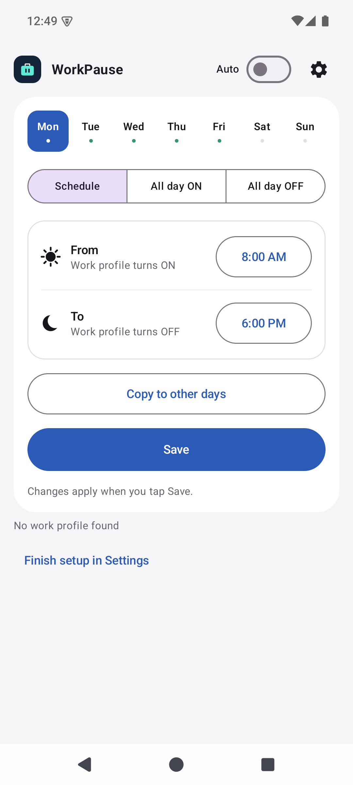

<!-- Modified for WorkPause: independent project documentation. -->
# WorkPause

[](https://github.com/marinfrankovic/WorkPause/releases/tag/v1.0.2)
[](#requirements-and-setup)
[](app/src/main/java/com/worksched)
[](app/src/main/java/com/worksched/ui)
[](LICENSE)
[](https://github.com/marinfrankovic/WorkPause/actions/workflows/build.yml)

**[Latest release: WorkPause 1.0.2 Preview](https://github.com/marinfrankovic/WorkPause/releases/tag/v1.0.2)**
 · **[Download signed APK](https://github.com/marinfrankovic/WorkPause/releases/download/v1.0.2/WorkPause-1.0.2.apk)**
 · **[Website](https://marinfrankovic.github.io/WorkPause/)**


**Work on your schedule.**

WorkPause pauses and resumes an existing Android work profile on selected weekdays.
It uses Android alarms rather than a continuous scheduler service.

## Features

- Three choices for every weekday: **Schedule**, **All day ON**, or **All day OFF**.
- **From → To** times define the hours when your work profile is ON.
- Copy one day's behavior and remembered hours to any other days.
- One **WorkPause ON/OFF** switch, applied immediately.
- **ON:** follow the saved schedule. **OFF:** leave work apps as set on the phone.
- Overnight hours and a **Save schedule** button for daily edits only.
- Compact single-row header with the WorkPause switch and Settings gear.
- Silent control after a one-time ADB permission grant.
- Deferred resume when Android requires the device or work profile to be unlocked.
- Material 3 interface and adaptive, round, and themed launcher icons.

## Using the scheduler

The compact top bar contains the app name, one **ON/OFF** switch, and Settings gear.
There are no separate Auto, Resume, or Pause controls.

- **WorkPause ON:** immediately follows your saved weekly schedule, including applying
  the current scheduled state.
- **WorkPause OFF:** stops WorkPause's scheduled changes, pending resumes, and queued
  fallback actions. It does not turn work apps on or off, restore an earlier state,
  or change Android's own settings or employer policy. Use the phone's normal controls
  while WorkPause is off.

The switch applies immediately and stays set after closing or restarting the app.
Your saved daily rules are retained when WorkPause is off.

Choose a day directly from the Monday-Sunday strip, then choose its behavior:

| Mode | Work profile behavior |
|---|---|
| Schedule | ON between **From** and **To**, OFF outside active scheduled hours. |
| All day ON | ON from local midnight to midnight. |
| All day OFF | OFF from local midnight to midnight, including any previous overnight hours. |

The two all-day modes use matching descriptions and hide the time fields.
Switching modes keeps the day's remembered From/To times. **Copy to other days**
copies both the mode and those times to the days you select.
Tap **Save schedule** to apply daily edits. Switching WorkPause on or off does not
save unfinished edits; ON always uses the last saved rules. Saving daily edits while
WorkPause is OFF does not turn it on or change the work profile.



## App identity

- Application ID: `io.github.marinfrankovic.workpause`
- Current version: `1.0.2` (version code `3`)
- Repository: [marinfrankovic/WorkPause](https://github.com/marinfrankovic/WorkPause)

WorkPause installs separately from the original application. Settings and permission
grants do not migrate automatically.
The fork retains upstream Git history. Commit messages shown beside unchanged files
describe their last edit, not the installed app version. Use the WorkPause release
linked above, not an inherited upstream tag.

## Requirements and setup

Android 10 or newer and an existing Android work profile are required. Samsung Secure
Folder is not a substitute for a work profile.

### Install with ADB

1. Download the signed `WorkPause-1.0.2.apk` from this repository's
   [Releases](https://github.com/marinfrankovic/WorkPause/releases) page.
   Preview versions may be marked **Pre-release**. Do not install APKs from untrusted mirrors.
2. Install Google's [Android SDK Platform Tools](https://developer.android.com/tools/releases/platform-tools)
   on your computer. Open a terminal in the folder containing `adb`, or add it to `PATH`.
3. On the phone, enable **Developer options** and **USB debugging**, connect by USB,
   and approve the debugging prompt for your trusted computer.
4. Check the connection, then install on the personal side of the phone:

   ```powershell
   adb devices
   adb install -r "C:\path\to\WorkPause-1.0.2.apk"
   ```

   Replace the example path with your downloaded APK. The device should appear as
   `device`, not `unauthorized`. If multiple devices are connected, use
   `adb -s DEVICE_SERIAL install -r "C:\path\to\WorkPause-1.0.2.apk"`.
   In PowerShell, use `.\adb.exe` instead of `adb` if running from the Platform Tools
   folder without adding it to `PATH`.
5. Open WorkPause from the launcher.

To check the installed version:

```powershell
adb shell dumpsys package io.github.marinfrankovic.workpause | Select-String "versionCode=|versionName="
```

Expect `versionName=1.0.2` and `versionCode=3`. On the phone, you can also check
**Settings → Apps → WorkPause → App info** (the exact layout varies by device).

The `-r` option updates an existing installation without clearing its data, provided
the application ID and signing certificate match. A debug APK or the original upstream
app is not a compatible signed update. Do not uninstall to resolve a signature mismatch
unless you accept losing that installation's settings and permission grants.

### Install without ADB or a computer

1. On the phone, open the [Releases](https://github.com/marinfrankovic/WorkPause/releases)
   page and download the signed WorkPause APK using your browser.
2. Open the download. If Android blocks installation, follow the prompt to allow
   **Install unknown apps** / **Allow from this source** for the browser or file manager
   you are using. Settings names vary by phone.
3. Return to the APK, tap **Install**, and open WorkPause. Install it on the personal
   side, not inside the managed work profile.
4. After installing, turn off that browser/file manager's permission to install unknown apps.

No root, USB debugging, or ADB is required just to install the APK. Android device
protection and employer policy may prevent sideloading; WorkPause cannot bypass them.

**Installing without ADB does not grant silent control.** To use the app without
the ADB grant, open WorkPause **Settings → Visible fallback → Accessibility settings**
and enable its accessibility service. This visibly operates Quick Settings rather than
silently switching the profile. On Android versions that restrict accessibility for
sideloaded apps, **Settings → Apps → WorkPause → menu → Allow restricted settings**
may be needed, if the device permits it. Only enable this for an APK you trust.
Some confirmation dialogs still require your input; device and employer restrictions
still apply.

### Configure profile control and scheduling

1. For recommended silent control, run this once from an authorized ADB host, even
   if you originally installed the APK directly on the phone:

   ```text
   adb shell pm grant io.github.marinfrankovic.workpause android.permission.MODIFY_QUIET_MODE
   ```

   For a multi-device connection, add `-s DEVICE_SERIAL` after `adb`.
   This is a separate setup step from installation. It normally survives reboot;
   uninstalling or reinstalling from scratch requires granting it again.
2. Open **Settings** using the gear. Status cards explain what needs attention.
   Expand **Set up with ADB** for instructions and a **Copy command** button.
3. Select a weekday and choose **All day OFF**, **All day ON**, or **Schedule**.
   For Schedule, set **From** and **To** to define the ON interval.
   Repeat for other days or use **Copy to other days**, then tap **Save schedule**.
4. In Settings, allow **Exact alarms** for precise timing. Unrestricted battery use is
   recommended to reduce delays; these permissions do not grant profile control.
   Turn **WorkPause ON** when you are ready to follow your saved schedule; no Save
   is required for the switch.

An earlier To time ends the work interval the next day. **All day OFF takes priority
at midnight**, including over the previous day's overnight interval. All day ON spans
local midnight to midnight, including clock-change days. Overlapping ON intervals
remain on until the combined interval ends. Previously disabled weekdays map to
All day OFF; review overnight schedules after updating. Turning off the
**WorkPause** switch immediately cancels automation without changing the current profile state.
Saving an enabled schedule also applies the current scheduled state.

The design is inspired by Samsung's simple settings layouts; it does not use proprietary
Samsung components or imply Samsung endorsement.

Accessibility is an optional, visible fallback, not a requirement for the silent backend.
If Android shows a confirmation during this fallback, confirm it and close Quick Settings
yourself; WorkPause does not automatically accept dialogs.
The app cannot bypass a device or work-profile PIN. Employer policy can restrict its use.

## Build and test

Use JDK 17 or 21 and the Android SDK. Set `JAVA_HOME` and `ANDROID_HOME`.
On Windows:

```powershell
.\gradlew.bat :app:assembleDebug :app:testDebugUnitTest :app:lintDebug
adb -s emulator-5556 install -r .\app\build\outputs\apk\debug\app-debug.apk
```

Replace `emulator-5556` with your device serial. This debug-install command is only
for a device without the differently signed release app installed.

The debug APK is for development only. Debug and release builds share the application
ID but use different signing keys; Android will not install one over the other.
Uninstalling clears that installation's settings and permission grants.

## Release signing

Release builds require WorkPause's private key and never fall back to debug signing.
Windows helpers store the PKCS12 keystore outside the repository, under
`%LOCALAPPDATA%\WorkPause\signing`, with access restricted to the current Windows account.
The randomly generated password is encrypted with Windows DPAPI.

Initialize once, then build:

```powershell
.\tools\Initialize-ReleaseSigning.ps1
.\tools\Build-Release.ps1
```

The signed APK is written to `app\build\outputs\apk\release\app-release.apk`.
For other environments, provide `WORKPAUSE_KEYSTORE_PATH`, `WORKPAUSE_STORE_PASSWORD`,
`WORKPAUSE_KEY_ALIAS`, and `WORKPAUSE_KEY_PASSWORD` securely before running
`:app:assembleRelease`. Never put passwords in command-line arguments, tracked files,
or logs. CI builds debug artifacts only and does not receive the release key.

**Backup is essential:** losing the private key or its password can prevent future
updates. DPAPI credentials are tied to this Windows user and machine; copying the
encrypted password file alone is not a portable recovery backup. Arrange a protected
off-device backup of the keystore and a separately secured password before distribution.

Increase `versionCode` for every published update. Version names and release tags are
managed independently from upstream.

## Status and limitations

- Emulator installation and appearance do not establish Samsung or enterprise compatibility.
- The current preview passed 31 unit tests, Android debug lint, release-signature checks,
  and emulator UI smoke checks. The emulator has no managed work profile, so this does
  not verify real profile toggling.
- The inherited external testing hook has been removed. Internal retry broadcasts are
  non-exported, accessibility is restricted to System UI, and generic confirmation
  buttons are no longer clicked automatically.
- This is an initial preview, not a general Samsung or enterprise compatibility certification.
- **User-confirmed on Samsung Galaxy S24 Ultra with One UI 9:** the owner personally
  tested WorkPause 1.0.2 and reports that it **works as expected**.
  Installation and setup readiness were also checked independently. The owner also
  reports needing the **work-profile PIN when the profile turns back on**. This is
  expected: silent control requests pause/resume but cannot unlock the profile or
  bypass its PIN. Other locked-device / credential scenarios and Intune / Knox
  compatibility remain unverified; individual functional scenarios were not recorded.
  See the [verification record](docs/VERIFICATION.md).

## Website

The [WorkPause website](https://marinfrankovic.github.io/WorkPause/) is a static,
responsive GitHub Pages site. Its source is in [site](site); artwork and the app
screenshot are shared with this documentation. The website uses Google Analytics
(`G-TMNRPH563S`) to measure website traffic; this tag is not added to the Android app.
There are no external fonts or build package dependencies.

To preview locally with Node.js 18+ and Python 3:

```powershell
node .\tools\build-site.mjs
python -m http.server 8080 --bind 127.0.0.1 --directory .site-build
```

Open `http://127.0.0.1:8080`. The Pages workflow builds and deploys changes to the
website, shared artwork, screenshot, or site builder after they reach `main`.

## Artwork

The original WorkPause icon combines a mint briefcase and negative-space pause symbol
on midnight blue. The editable source is [docs/workpause-icon.svg](docs/workpause-icon.svg).

## License and attribution

Licensed under [Apache License 2.0](LICENSE). Based on
[Work Profile Scheduler](https://github.com/ravindrasan1997/work-profile-scheduler),
Copyright 2026 Ravindra. Required attribution is retained in [NOTICE](NOTICE).
WorkPause is an independently maintained fork and does not imply upstream endorsement.
